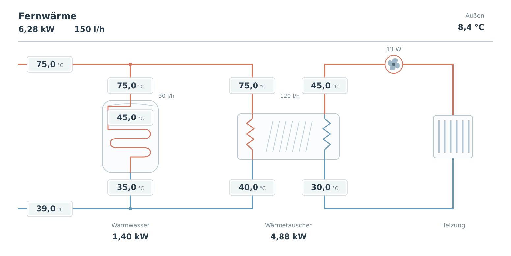

# District Heat Flow Card

A Home Assistant dashboard card for a district heating connection with a directly
heated domestic hot water storage tank and a separate space-heating heat exchanger.



## Features

- Hydraulic schematic with separate primary and secondary circuits.
- Aligned temperature displays for supply and return connections.
- Storage temperature, total heat power and flow, and optional branch measurements.
- Animated heating pump and electrical pump power.
- Visual configuration editor with searchable entity selectors.
- Click or keyboard activation opens the Home Assistant entity details.
- Home Assistant theme colors and reduced-motion support.

The card is a display component. It does not calculate branch flows or heat powers,
create entities, or switch the pump directly. Missing values appear as `–`.
The current visual editor labels are German.

## Install with HACS

1. In HACS, open **Custom repositories**.
2. Add `https://github.com/schoppfe/ha-district-heat-flow-card` with type **Dashboard**.
3. Download **District Heat Flow Card** and reload the browser.
4. Edit your dashboard, add **District Heat Flow Card**, and select your entities
   in the visual editor.

For UI-managed resources, HACS registers the JavaScript module automatically.
For YAML-managed resources, add the following resource to your existing resource list:

```yaml
- url: /hacsfiles/ha-district-heat-flow-card/ha-district-heat-flow-card.js
  type: module
```

This repository is intended for installation as a custom HACS repository. Inclusion
in the default HACS catalog is not required for that installation method.

## Configuration

All displays can be assigned through the visual editor. No guessed entity IDs are
inserted when adding a new card. The corresponding YAML starts with:

```yaml
type: custom:ha-district-heat-flow-card
title: Fernwärme
entities: {}
```

Add your entity IDs under `entities` using the following keys:

| Key | Display |
| --- | --- |
| `primary_supply_temperature` | Common district heating supply temperature |
| `primary_return_temperature` | Mixed district heating return temperature |
| `primary_flow` | Total district heating flow |
| `primary_power` | Total thermal power |
| `storage_temperature` | Domestic hot water storage temperature |
| `dhw_primary_return_temperature` | Storage heating register return temperature |
| `heating_primary_return_temperature` | Heat exchanger primary return temperature |
| `heating_secondary_supply_temperature` | Space-heating secondary supply temperature |
| `heating_secondary_return_temperature` | Space-heating secondary return temperature |
| `heating_pump` | Pump on/off entity |
| `heating_pump_power` | Electrical pump power |
| `outdoor_temperature` | Numeric outdoor temperature sensor |
| `dhw_primary_flow` | Optional storage register flow |
| `heating_primary_flow` | Optional heat exchanger primary flow |
| `dhw_power` | Optional heat power transferred to the storage register |
| `heating_power` | Optional heat power transferred from the primary heating branch |

Supply temperature is assumed equal at the district heating inlet, storage register
inlet, and heat exchanger primary inlet. Those three displays share one entity.
Storage heat power is not the hot water draw-off power or stored energy.

The card reads numeric sensor states and their units. It does not automatically
convert displayed units. Common °C, °F, W, kW, l/h and m³/h formats are supported.
The outdoor field currently accepts a numeric sensor, not a weather entity.

An explicit `on` or `off` pump state takes precedence over electrical power. If it
is unavailable, power above `pump_power_threshold` (default 0.5 W) indicates running;
W and kW are supported for this decision. An unknown pump state shows `?`.

## Layout

The schematic scales with the available card width, with a minimum width of
780 CSS pixels. Narrow cards scroll horizontally. Place it in a wide dashboard
area for best readability. A separate portrait layout is not currently included.
The pump position is schematic; the drawing is not an installation plan.

## Updating

Install updates through HACS and reload the browser. Entity mappings are stored in
the dashboard configuration.

### Migration from Thermo-Hydraulic Card

This is a deliberate rename without a compatibility alias.

1. Install the new card through HACS.
2. Change the existing card type to `custom:ha-district-heat-flow-card`.
3. Keep the existing `entities` mappings and other configuration settings.
4. Remove the old `/local/thermo-hydraulic-card/thermo-hydraulic-card.js` resource.
5. Reload the browser.

## Development and releases

The card is a single JavaScript file with no build step or external JavaScript
runtime dependencies. The README image is documentation only; all card graphics
are inline SVG.

Version 0.5.0 renames the card and adds HACS packaging. Its layout corresponds to
version 0.4.0 of Thermo-Hydraulic Card. Syntax, render logic, entity interactions,
editor configuration updates and package consistency have been checked locally.
Installation through HACS still requires validation in a running Home Assistant
instance after the repository is published.

Use versioned GitHub releases and attach `ha-district-heat-flow-card.js` as the
release asset. Describe changes in the release notes.

## License

MIT. See [LICENSE](LICENSE).
